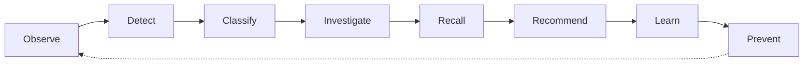
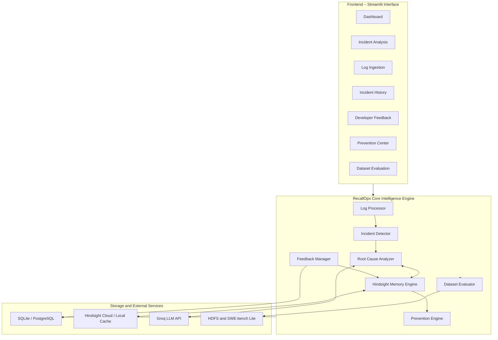

# RecallOps – AI Incident Response & Prevention Agent

**Tagline:** *Every Failure Becomes Experience. Every Experience Builds Intelligence.*

## 1. Project Overview

RecallOps is an AI-powered incident intelligence and response platform designed to transform software failures into persistent, reusable organizational knowledge.

Traditional incident management systems primarily focus on detecting, reporting, and resolving individual incidents. However, they often lack an effective mechanism for retaining verified resolutions and applying previously acquired knowledge to recurring failures.

RecallOps addresses this limitation through an experience-driven learning approach. It captures incident information, investigates potential root causes, retrieves relevant historical experiences, and recommends previously verified solutions.

By integrating Hindsight long-term memory, RecallOps retains successful resolutions and unsuccessful approaches, enabling the system to learn from previous incidents and improve future recommendations.

The platform also identifies recurring failure patterns and generates preventive recommendations to minimize repeated incidents.

### Key Features

- Automated log ingestion and incident detection.
- Classification of incidents into ten standard failure categories.
- AI-assisted root cause analysis.
- Historical incident retrieval and similarity matching.
- Human-verified feedback and long-term memory retention.
- Detection of recurring incidents and anti-patterns.
- Automated prevention recommendations and runbook generation.
- Offline dataset evaluation and performance analysis.

## 2. Core Experience-Learning Workflow

RecallOps follows an eight-stage incident intelligence workflow.

1. **Observe:** Collects server logs, stack traces, and cluster telemetry.
2. **Detect:** Extracts timestamps, error levels, affected components, and relevant evidence.
3. **Classify:** Categorizes incidents into ten predefined failure categories and assigns severity levels.
4. **Investigate:** Generates root-cause hypotheses using Groq LLaMA 3.3 70B, with a deterministic evidence-based fallback.
5. **Recall:** Retrieves relevant historical experiences and previously recorded resolutions from Hindsight memory.
6. **Recommend:** Prioritizes verified solutions and identifies previously successful remediation approaches.
7. **Learn:** Incorporates developer feedback to retain confirmed solutions and unsuccessful approaches in long-term memory.
8. **Prevent:** Identifies recurring patterns and generates preventive recommendations and runbooks.

### Experience-Learning Cycle



This continuous feedback cycle enables RecallOps to move beyond conventional incident monitoring towards experience-based incident resolution and prevention.

## 3. System Architecture

RecallOps is organized into three major architectural layers.

### 3.1 Frontend – Incident Management Interface

The Streamlit-based command center provides the following modules:

- Dashboard and Incident Overview
- Incident Analysis and Investigation
- Log Upload and Ingestion
- Incident History and Audit Trail
- Developer Feedback Management
- Prevention Recommendations
- Offline Dataset Evaluation
- System Health and Configuration

### 3.2 Core Intelligence Engine

| Module | Responsibility |
|---|---|
| Log Processor | Parses log files and extracts relevant information |
| Incident Detector | Identifies failure categories and severity |
| Root Cause Analyzer | Generates root-cause hypotheses and recommendations |
| Hindsight Memory Engine | Stores and retrieves historical experiences |
| Feedback Manager | Processes developer feedback and verification |
| Prevention Engine | Identifies recurring patterns and generates runbooks |
| Dataset Evaluator | Evaluates system performance using benchmark datasets |

### 3.3 Storage and External Services

- **Relational Database:** SQLite / PostgreSQL for structured incident records and feedback.
- **Hindsight Memory:** Cloud-based long-term memory with persistent local caching.
- **Groq API:** LLaMA 3.3 70B for AI-assisted root cause analysis.
- **Benchmark Datasets:** HDFS cluster telemetry and SWE-bench Lite defect knowledge.

### Architecture Diagram



## 4. Standard Incident Classification

RecallOps classifies incoming failure signatures into ten predefined categories.

| Failure Category | Typical Error Signatures | Severity |
|---|---|---|
| Database Connection Errors | HikariPool timeout, connection refused, connection exhaustion, deadlocks | High – Critical |
| Authentication Errors | Expired JWT, HTTP 401, HTTP 403, invalid credentials | High |
| Memory Errors | OutOfMemoryError, OOMKilled, heap saturation | Critical |
| Network Errors | Broken pipe, socket timeout, connection reset | Medium – High |
| API Failures | HTTP 502, 503, 504, 429 | High |
| Application Exceptions | NullPointerException, AttributeError, KeyError, TypeError | Medium – High |
| Configuration Errors | Missing environment variables, malformed YAML/JSON, invalid settings | Medium |
| Dependency Errors | ModuleNotFoundError, ImportError, package version conflicts | Medium |
| Resource Exhaustion | Disk space exhaustion, file descriptor limits, thread saturation | Critical |
| Unknown / Unclassified | Unrecognized or previously unseen failure signatures | Low – Medium |

The classification engine combines predefined failure patterns, evidence extraction, and severity assessment to support consistent incident triage.

## 5. Technology Stack

| Component | Technology |
|---|---|
| Programming Language | Python |
| Frontend | Streamlit |
| AI / LLM Integration | Groq LLaMA 3.3 70B |
| Long-Term Memory | Hindsight |
| Database | SQLite / PostgreSQL |
| Data Processing | Pandas, NumPy |
| Similarity Retrieval | FAISS / Cosine Similarity |
| Benchmark Datasets | HDFS, SWE-bench Lite |
| Testing Framework | Pytest |
| Environment Configuration | Python dotenv |

## 6. Installation and Configuration

### 6.1 Prerequisites

- Python 3.10, 3.11, or 3.12.
- Windows, macOS, or Linux.
- Internet connection for optional cloud integrations.

### 6.2 Install Dependencies

```bash
cd RecallOps
pip install -r requirements.txt
```

### 6.3 Environment Configuration

RecallOps supports offline operation using deterministic fallback intelligence and persistent local memory.

Optional cloud integrations can be configured through the `.env` file.

```env
# Groq LLM Configuration
GROQ_API_KEY=your_groq_api_key

# Hindsight Memory Configuration
HINDSIGHT_API_URL=https://api.hindsight.ai/v1
HINDSIGHT_API_KEY=your_hindsight_api_key

# Database Configuration
DATABASE_URL=sqlite:///data/recallops.db
```

### 6.4 Launch the Application

```bash
streamlit run src/app.py
```

Access the application through:

`http://localhost:8501`

## 7. Offline Dataset Benchmarks and Evaluation

RecallOps incorporates two datasets for offline evaluation and incident knowledge retrieval.

### 7.1 HDFS Cluster Telemetry

The HDFS dataset is used to evaluate log classification and anomaly detection performance.

### 7.2 SWE-bench Lite

SWE-bench Lite provides software engineering defect instances that can be used for similarity retrieval and patch-related knowledge analysis.

### Reported Evaluation Results

| Evaluation Metric | HDFS Dataset | SWE-bench Lite |
|---|---:|---:|
| Dataset Size | 2,000 log records | 300 defect instances |
| Classification Accuracy | 99.85% | Not Applicable |
| Precision | 98.77% | Not Applicable |
| Recall | 97.56% | Not Applicable |
| F1-Score | 98.16% | Not Applicable |
| Verified Patch Availability | Not Applicable | 100% (300/300) |
| Mean Retrieval Latency | Below 1 ms | 1.24 ms |
| Mean Top-1 Cosine Similarity | Not Applicable | 0.522 |

*Note: These are the evaluation figures reported by the current implementation. They should be independently reproduced and validated before being presented as experimentally established results.*

## 8. Automated Testing and Verification

RecallOps includes an automated test suite designed to verify its major functional components.

Run the test suite using:

```bash
pytest tests/test_recallops.py -v
```

### Verification Points

1. **Log Ingestion:** Handles multiline stack traces and empty log inputs.
2. **Category Classification:** Validates all ten standard incident categories.
3. **Severity Estimation:** Checks Critical, High, Medium, Low, and Informational levels.
4. **Incident Investigation:** Validates structured investigation output and recommendations.
5. **Root Cause Confidence:** Supports Confirmed, Likely, and Possible confidence levels.
6. **Hindsight Retention:** Stores incident metadata and verified experiences.
7. **Hindsight Recall:** Retrieves and ranks relevant historical memories.
8. **Anti-Pattern Detection:** Identifies previously unsuccessful approaches.
9. **Experience Learning:** Validates the incident-to-feedback-to-memory cycle.
10. **Database Persistence:** Tests SQLite/PostgreSQL data persistence.
11. **Feedback Management:** Tests all six feedback workflows.
12. **Feedback Analytics:** Evaluates resolution success and recommendation adoption.
13. **Prevention Engine:** Identifies recurring patterns and generates runbooks.
14. **Dataset Evaluation:** Evaluates HDFS classification and SWE-bench retrieval.
15. **Application Scenarios:** Validates the five predefined test scenarios.

*The 15/15 passing status should be stated only when confirmed by the latest test execution.*

## 9. Project Directory Structure

```text
RecallOps/
│
├── config/
│   └── settings.py
│
├── data/
│   ├── HDFS_2k.log_structured.csv
│   ├── swebench_lite.csv
│   ├── recallops.db
│   └── hindsight_local_cache.json
│
├── demo_samples/
│   ├── sample1_database_timeout_initial.log
│   ├── sample2_database_timeout_recurrence.log
│   ├── sample3_memory_oomkill.log
│   ├── sample4_authentication_jwt_expired.log
│   └── sample5_empty.log
│
├── processed_data/
│   ├── hdfs_clean.csv
│   └── swebench_clean.csv
│
├── reports/
│   ├── event_frequency.csv
│   ├── log_level_distribution.csv
│   ├── rare_hdfs_events.csv
│   └── similar_swe_issues.csv
│
├── src/
│   ├── app.py
│   ├── database.py
│   ├── incident_manager.py
│   ├── log_processor.py
│   ├── incident_detector.py
│   ├── root_cause_analyzer.py
│   ├── hindsight_memory.py
│   ├── feedback_manager.py
│   ├── prevention_engine.py
│   ├── dataset_evaluator.py
│   ├── ai_agent.py
│   ├── hdfs_analyzer.py
│   └── swe_analyzer.py
│
├── tests/
│   └── test_recallops.py
│
├── inspect_datasets.py
├── preprocess_datasets.py
├── test_hindsight.py
├── test_swebench_memory.py
├── requirements.txt
├── .env.example
└── README.md
```

## 10. Expected Outcomes

RecallOps aims to improve incident management by introducing a continuous experience-learning mechanism.

Its expected outcomes include:

- Reduced time spent investigating recurring software failures.
- Improved access to historical incident resolutions.
- Better consistency in root-cause analysis.
- Preservation of organizational troubleshooting knowledge.
- Identification of repeated failure patterns.
- Reduced dependence on manual incident investigation.
- Proactive prevention through experience-based recommendations.

## 11. Conclusion

RecallOps introduces an experience-driven approach to software incident management by combining automated log analysis, AI-assisted investigation, long-term memory, and developer feedback.

Instead of treating every incident as an isolated problem, the platform builds a reusable knowledge base from previous experiences. Verified resolutions can be retrieved and applied to similar future incidents, while unsuccessful approaches help identify potential anti-patterns.

Through its integration of Hindsight long-term memory and AI-assisted analysis, RecallOps aims to evolve from a conventional incident monitoring solution into an intelligent incident response and prevention platform.

**RecallOps – Every Failure Becomes Experience. Every Experience Builds Intelligence.**