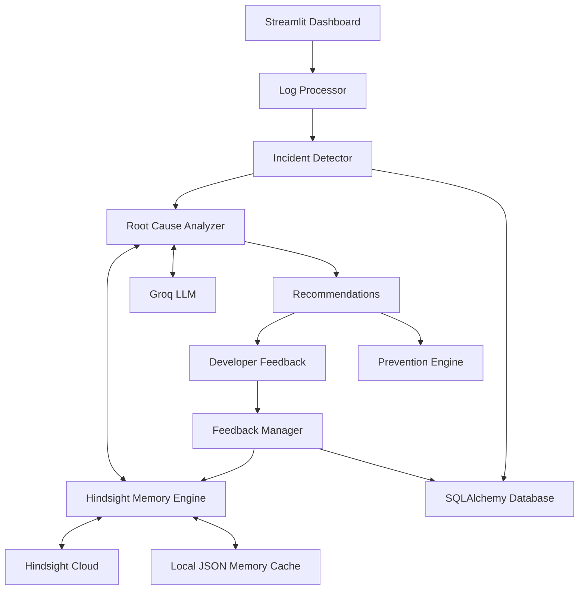

# How Hindsight Helps RecallOps Reuse Incident Fixes

*Building an AI-powered incident response agent that learns from previous failures, recalls verified solutions, and helps engineering teams investigate recurring issues.*

---

## The Problem: Why Do We Keep Solving the Same Incidents?

Imagine an on-call engineer receiving an alert at 2:15 AM:

```text
HikariPool-1 - Connection is not available,
request timed out after 30005ms
```

The engineer begins investigating database metrics, application logs, and network connections. After several checks, the error looks familiar. A similar issue may have occurred in another service weeks earlier, but the previous investigation and its solution are buried in old messages, terminal histories, or post-mortem documents.

Without access to that experience, the engineer may have to repeat the same troubleshooting process.

This highlights a common challenge in software operations: **engineering teams often spend time rediscovering solutions to problems they have already encountered.**

Traditional monitoring tools can detect failures and generate alerts, while AI assistants can analyze logs and suggest possible causes. However, an assistant without persistent memory may not have access to the outcomes of previous investigations.

We built **RecallOps** to address this problem. By integrating [Hindsight](https://github.com/vectorize-io/hindsight), RecallOps can retain incident experiences and retrieve relevant information during future investigations.

The goal is simple: turn previous incident knowledge into reusable operational intelligence.

---

## Why Traditional AI-Based Error Analysis Is Not Enough

Large language models can interpret stack traces, identify common error patterns, and suggest troubleshooting steps. However, a standalone model does not automatically retain an engineering team's previous incident history between independent sessions.

For example, when an engineer submits a database timeout error, an AI assistant might recommend checking database availability, network connectivity, credentials, and connection pool settings.

These suggestions may be technically reasonable, but they do not necessarily reflect what has already been investigated or what previously resolved the same issue.

A more useful incident response system needs access to historical context, including:

- Previous error signatures and incident descriptions.
- Root causes identified during earlier investigations.
- Solutions applied by developers.
- Whether those solutions were successful.
- Troubleshooting attempts that did not work.

This is where persistent agent memory becomes important. Hindsight provides the memory layer that allows RecallOps to retain and recall information across investigations.

---

## Introducing RecallOps

[Insert screenshot of the RecallOps incident analysis interface]

**RecallOps** is an AI-powered incident response and prevention system designed to help engineering teams investigate software failures using historical incident knowledge.

It combines log processing, incident classification, root-cause analysis, persistent memory, and developer feedback in one application.

Its workflow follows this sequence:

**Observe → Detect → Classify → Investigate → Recall → Recommend → Learn → Prevent**

When a developer submits an error log, RecallOps:

1. Extracts useful information such as timestamps, components, log levels, and error signatures.
2. Classifies the incident into categories such as database, memory, network, authentication, and application errors.
3. Searches the relevant Hindsight memory bank for previous experiences.
4. Uses retrieved information as additional context during root-cause analysis.
5. Presents possible causes, recommendations, and warnings about previously unsuccessful solutions.
6. Collects developer feedback and retains useful incident outcomes for future investigations.

This workflow helps connect current troubleshooting with previously recorded engineering experience.

---

## System Architecture

RecallOps follows a modular Python architecture with a Streamlit-based interface.



### Main Components

**1. Streamlit Command Center**

The frontend is developed using Streamlit and Plotly. It provides incident dashboards, investigation views, memory status, feedback forms, and prevention insights.

**2. Log Processor and Incident Detector**

The log processor extracts information from submitted logs. The incident detector uses rule-based patterns and heuristics to classify failures and estimate their severity.

**3. Root-Cause Analyzer**

The investigation engine uses Groq inference with the `llama-3.3-70b-versatile` model to analyze incidents. It also has an evidence-based fallback path for situations where cloud inference is unavailable.

**4. Hindsight Memory Engine**

This component connects RecallOps to Hindsight memory banks. It handles memory retention, retrieval, and local fallback storage.

**5. Database and Feedback Manager**

SQLAlchemy manages incident records and feedback. SQLite is supported by default, while PostgreSQL can be configured through the database connection settings.

**6. Prevention Engine**

The prevention engine analyzes available incident and dataset information to generate prevention insights and runbooks. These are recommendations for engineering teams, not automatic changes to live infrastructure.

---

## The Technical Story: Integrating Hindsight Memory

[Insert screenshot of Hindsight memory retrieval interface]

The central feature of RecallOps is its integration with [Hindsight](https://hindsight.vectorize.io/).

Instead of treating every investigation as a completely separate task, RecallOps uses memory banks to organize information by domain:

- `incident-intelligence`
- `hdfs-intelligence`
- `swebench-intelligence`

This allows the application to work with different types of engineering knowledge.

### 1. Retaining Incident Experiences

When developers submit feedback, RecallOps processes the outcome and prepares an incident memory.

For example, when a developer confirms that a solution worked, the system creates a record containing the incident identifier, error signature, category, root cause, applied solution, and outcome.

The memory engine saves the structured incident information in its local JSON cache and attempts to retain the corresponding content in Hindsight when cloud credentials are configured.

The important part is that memory is not limited to error messages. It can also preserve the troubleshooting outcome and the developer's feedback.

### 2. Recalling Previous Experiences

During a new investigation, RecallOps queries the relevant Hindsight memory bank using the current incident information.

When Hindsight Cloud is configured, the application uses the Hindsight recall API to retrieve matching experiences.

RecallOps also includes a local persistent fallback. This fallback compares query tokens against stored incident summaries, solutions, categories, and notes, with additional keyword boosts for recognized error patterns.

It is important to distinguish these mechanisms: the local fallback uses token-overlap and keyword-based scoring; it is not a vector-embedding search.

The retrieved information is passed to the root-cause analyzer as additional context. This helps the system consider previous resolutions instead of relying only on generic troubleshooting suggestions.

### 3. Learning from Failed Solutions

Successful fixes are valuable, but unsuccessful troubleshooting attempts are equally important.

RecallOps supports a human-in-the-loop feedback workflow. Developers can report outcomes such as:

- Solution successful.
- Alternative solution applied.
- Solution unsuccessful.
- Partially successful.
- Incorrect root cause.
- Additional troubleshooting information.

When a solution is unsuccessful, RecallOps records it as an anti-pattern with the attempted solution and the reported reason for failure.

During later investigations, the analyzer can use this information to generate warnings against repeating unsuccessful approaches.

### 4. Closing the Learning Loop

The overall learning process is:

```text
New Incident
     ↓
Log Processing and Classification
     ↓
Historical Memory Retrieval
     ↓
Root-Cause Analysis
     ↓
Recommended Actions
     ↓
Developer Verification
     ↓
Memory Retention
     ↓
Future Incident Investigation
```

[Insert diagram of the RecallOps experience-learning lifecycle]

This feedback loop allows incident knowledge to grow as developers investigate and resolve problems.

---

## A Practical Example: Recurring Database Connection Errors

Consider an illustrative database timeout scenario.

### Incident 1: Initial Occurrence

A developer submits the following log:

```text
[payment-service] ERROR com.zaxxer.hikari.pool.HikariPool
Connection is not available, request timed out after 30005ms.

FATAL: remaining connection slots are reserved
for non-replication superuser connections
```

RecallOps processes the log and classifies it as a database connection issue.

The investigation may identify connection pool exhaustion as a possible cause. The engineer then investigates the actual database and application metrics to determine the underlying problem.

Suppose the engineer discovers that the configured connection pool is saturated and applies an appropriate configuration change.

After confirming that the change resolves the issue, the developer submits **Solution successful** feedback.

RecallOps records the verified outcome in its local memory cache and attempts to retain the incident experience in Hindsight.

### Incident 2: A Similar Error Occurs Again

Later, another service reports a similar connection timeout:

```text
[order-fulfillment] WARN com.zaxxer.hikari.pool.HikariPool
Connection acquisition timed out after 30000ms:
pool exhausted (active=50, idle=0, waiting=12)
```

This time, RecallOps can search its available memory sources for relevant previous experiences.

If the earlier incident is retrieved, the system can present its recorded solution and outcome as useful context for the new investigation.

The engineer can compare the previous incident with the current evidence before deciding whether the earlier fix is applicable.

The important difference is that the investigation can begin with historical knowledge rather than relying entirely on generic suggestions.

*This example illustrates the intended workflow; it is not a measured production benchmark.*

---

## Technical Challenges and Lessons Learned

Developing RecallOps highlighted several important engineering considerations.

### 1. Preserving Both Successful and Unsuccessful Experiences

Storing only successful solutions provides an incomplete picture of incident history. Failed attempts can also help engineers avoid repeating ineffective troubleshooting steps.

RecallOps addresses this through its feedback workflows and anti-pattern records.

### 2. Handling External Service Failures

A memory service may become unavailable because of network or configuration issues. To improve resilience, RecallOps maintains a local JSON memory cache and attempts to use it when Hindsight Cloud cannot be reached.

This provides a local fallback, although cloud memory and local memory may not contain identical records.

### 3. Avoiding Incorrect Conclusions from Similar Logs

Two incidents can produce similar error messages but have different root causes.

For this reason, historical matches should be treated as supporting evidence rather than unquestionable answers. Engineers must compare retrieved solutions with current logs, metrics, and system conditions before applying a fix.

### 4. Keeping Developers in the Decision Loop

AI-generated recommendations should not replace engineering judgment. RecallOps includes developer verification so that incident outcomes can be recorded and used as context in later investigations.

---

## What RecallOps Brings to Incident Response

By combining incident analysis with persistent memory, RecallOps aims to make operational knowledge easier to reuse.

Its main contributions include:

- **Reusable engineering knowledge:** Previous incident outcomes can be retained and retrieved during future investigations.
- **Context-aware troubleshooting:** Historical experiences provide additional context for root-cause analysis.
- **Anti-pattern awareness:** Previously unsuccessful approaches can be highlighted to help engineers avoid repeating them.
- **Human-verified learning:** Developer feedback helps distinguish successful, partial, and unsuccessful outcomes.
- **Prevention insights:** Recurring patterns can be used to generate recommendations and runbooks for engineering teams.

These capabilities help move incident response beyond isolated log analysis toward a more continuous, experience-driven workflow.

---

## Conclusion

Recurring software incidents are not always caused by a lack of technical knowledge. Sometimes, the knowledge already exists but is difficult to find when it is needed.

RecallOps explores how persistent agent memory can help address this challenge. By integrating Hindsight with log processing, incident analysis, developer feedback, and prevention insights, the system connects current investigations with previously recorded engineering experiences.

The broader lesson is that an AI incident response agent becomes more useful when it can work with the history of the systems and teams it supports.

**With RecallOps, the goal is not just to analyze the next incident, but to make the experience gained from every investigation useful for the next one.**

---

## References and Resources

- [RecallOps – Project Repository](https://github.com/harshithachomi/RecallOps.git)
- [Hindsight – GitHub Repository](https://github.com/vectorize-io/hindsight)
- [Hindsight Documentation](https://hindsight.vectorize.io/)
- [What Is Agent Memory?](https://vectorize.io/what-is-agent-memory)